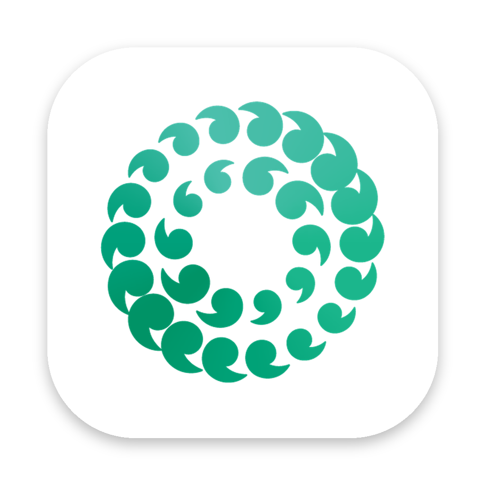

# Misk Scribe



**Hold a key. Speak. Done.**

Misk Scribe is a small Mac app for dictation. Hold down one key, say what you want to
type, let go, and your words appear wherever your cursor is: an email, a
document, a message, anything.

---

## Privacy, in plain English

- Misk Scribe turns your speech into text **entirely on your own Mac**.
- Your voice is **never saved** and **never sent over the internet**.
- No one, including the school or the app's creator, can see or track what you dictate.
- The **only** time Misk Scribe uses the internet is the very first time it opens, to download its speech model (see below).
- Misk Scribe has **no accounts, no logins, no tracking, and no usage limits**.

One honest note: the text goes wherever *you* put it. If you dictate into Gmail,
it's in Gmail, the same as if you'd typed it.

---

## What you need

- A Mac with an Apple chip (M1 or newer), running macOS 14 (Sonoma) or later. All 2023 MacBook Airs qualify.
- A microphone. MacBooks have one built in. **Mac Studio and Mac mini don't**, so
  use AirPods, a headset, a webcam with a mic, or an Apple Studio Display.
- About **0.6–1.5 GB** of free space. Misk Scribe picks a speech model that suits your Mac; 8 GB MacBook Airs get a compact version (about 600 MB).

---

## How to install it

1. **Download** `Misk-Scribe.zip` (from the Releases page of this project, or from wherever you were sent it).
2. **Double-click** the zip to unpack it. You'll get **Misk Scribe**.
3. **Drag Misk Scribe** into your **Applications** folder.
4. **Open Misk Scribe** from Applications.
   - The first time, your Mac will say it **"could not verify"** Misk Scribe. This is
     normal for apps not sold through Apple's App Store.
   - Click **Done** (not "Move to Bin").
   - Open **System Settings → Privacy & Security**, scroll down, and click
     **Open Anyway** next to the Misk Scribe message. Confirm with your password.
5. A small **waveform icon** appears at the top of your screen, near the clock.
   That's Misk Scribe.

### Allow the two permissions

Misk Scribe will ask for these the first time:

| Permission | Why it's needed | What to do |
|---|---|---|
| **Microphone** | So it can hear you | Click **Allow** |
| **Accessibility** | So it can notice your key and type into other apps | Click **Open System Settings**, then turn **Misk Scribe** on |

If either is still missing, clicking the waveform icon shows an **Allow…** button for it.

### Wait for the first download

The first time Misk Scribe opens, it downloads its speech model. While that happens the icon
shows a **downward arrow**. Depending on your internet connection, this takes from a
few seconds to a few minutes. After that, Misk Scribe works fully offline.

### If you're using the 🌐 Fn key (the default)

On most Macs, pressing 🌐 Fn opens emojis or Apple's own dictation. Switch that off so
it doesn't get in the way:

**System Settings → Keyboard → "Press 🌐 key to" → Do Nothing**

Or pick a different key: click the waveform icon → **Shortcut** →
**Right Option** or **Right Command**.

---

## How to use it

1. Click where you want the text to go.
2. **Hold** your push-to-talk key (🌐 Fn by default).
3. A small **green waveform** appears at the bottom of the screen and moves with your voice. Speak.
4. **Let go.** The waveform ripples for a moment, then your words appear.

---

## Troubleshooting

| Problem | Fix |
|---|---|
| Nothing happens when I hold the key | Click the waveform icon. If it shows **Allow Accessibility…**, click it. If you use 🌐 Fn, set "Press 🌐 key to" to **Do Nothing** (see above). |
| "No microphone found" | Connect a microphone or headset. Check **System Settings → Sound → Input**. |
| Text is copied but not pasted | Accessibility isn't allowed yet. Turn Misk Scribe on in **System Settings → Privacy & Security → Accessibility**. |
| **After installing a new version**, the key stops working | Go to **System Settings → Privacy & Security → Accessibility**, select Misk Scribe, click **–** to remove it, then open Misk Scribe again and allow it. (This goes away once the app is signed with an Apple Developer account.) |

---

## For IT staff

- Native Swift/AppKit menu-bar app (`LSUIElement`), not sandboxed (Accessibility requires this).
- The model is picked per device by `WhisperKit.recommendedModels()`; Macs with 8 GB of memory use the compressed (~600 MB) variant.
- Speech-to-text: [WhisperKit](https://github.com/argmaxinc/argmax-oss-swift) running OpenAI Whisper via Core ML on-device. The model is downloaded once from Hugging Face (`argmaxinc/whisperkit-coreml`) into `~/Library/Application Support/Misk Scribe/Models`. That is the app's only network access.
- Audio is held in memory only while the key is down and is discarded after transcription. Nothing is written to disk.
- Text is inserted by placing it on the pasteboard (marked `org.nspasteboard.TransientType` / `ConcealedType` so clipboard managers skip it), sending ⌘V, then restoring the previous pasteboard contents.
- No analytics, crash reporting, or auto-update code.
- Permissions: Microphone (`NSMicrophoneUsageDescription`) and Accessibility (event tap for the push-to-talk key, plus synthetic ⌘V).
- Currently ad-hoc signed. For managed deployment, sign with a Developer ID, notarize, and push via MDM with a PPPC profile pre-approving Accessibility. Bundle ID: `com.miskschools.scribe`.

## For developers

```bash
cd MiskScribe
./scripts/build-app.sh          # → build/Misk Scribe.app and build/Misk-Scribe.zip
open "build/Misk Scribe.app"
```

Every push that changes `MiskScribe/` is built automatically by
`.github/workflows/build-misk-scribe.yml` on GitHub's Mac machines. The result is published as
the **"Misk Scribe — latest build"** release.

| File | What it does |
|---|---|
| `Sources/MiskScribe/AppDelegate.swift` | Connects everything; the menu bar menu |
| `Sources/MiskScribe/HotkeyMonitor.swift` | Notices the push-to-talk key going down/up |
| `Sources/MiskScribe/AudioRecorder.swift` | Records the microphone into memory (16 kHz mono) |
| `Sources/MiskScribe/Transcriber.swift` | Speech → text with Whisper, on-device |
| `Sources/MiskScribe/TextInserter.swift` | Pastes the text into the app you're using |
| `Sources/MiskScribe/HUDController.swift` | The green waveform pill |
| `Sources/MiskScribe/Permissions.swift` | Microphone and Accessibility checks |
| `Sources/MiskScribe/Brand.swift` | App name, Misk greens, privacy wording |
| `Support/Branding/` | Misk Schools logo and the app icon made from it |
